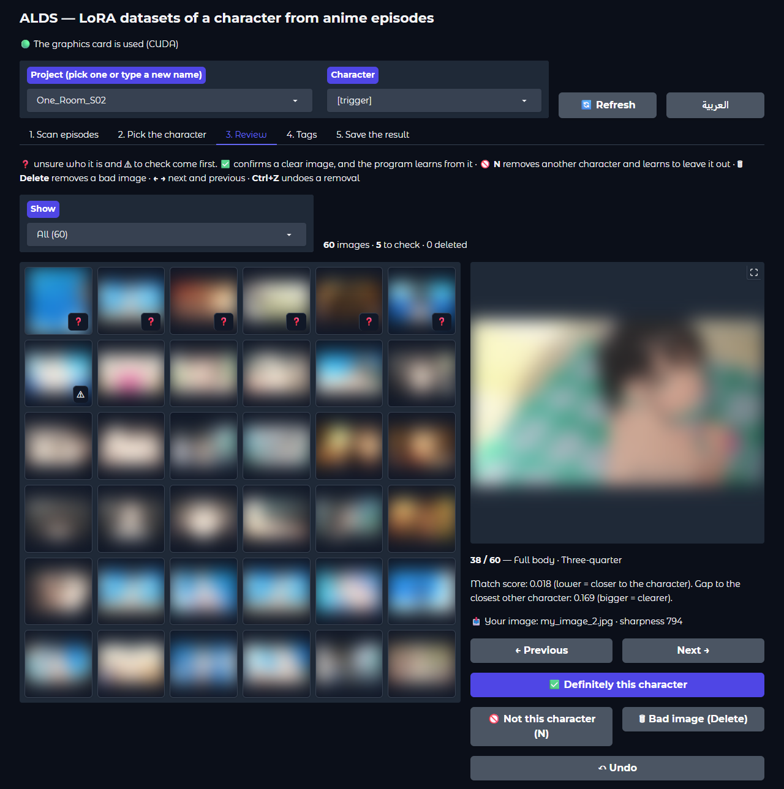
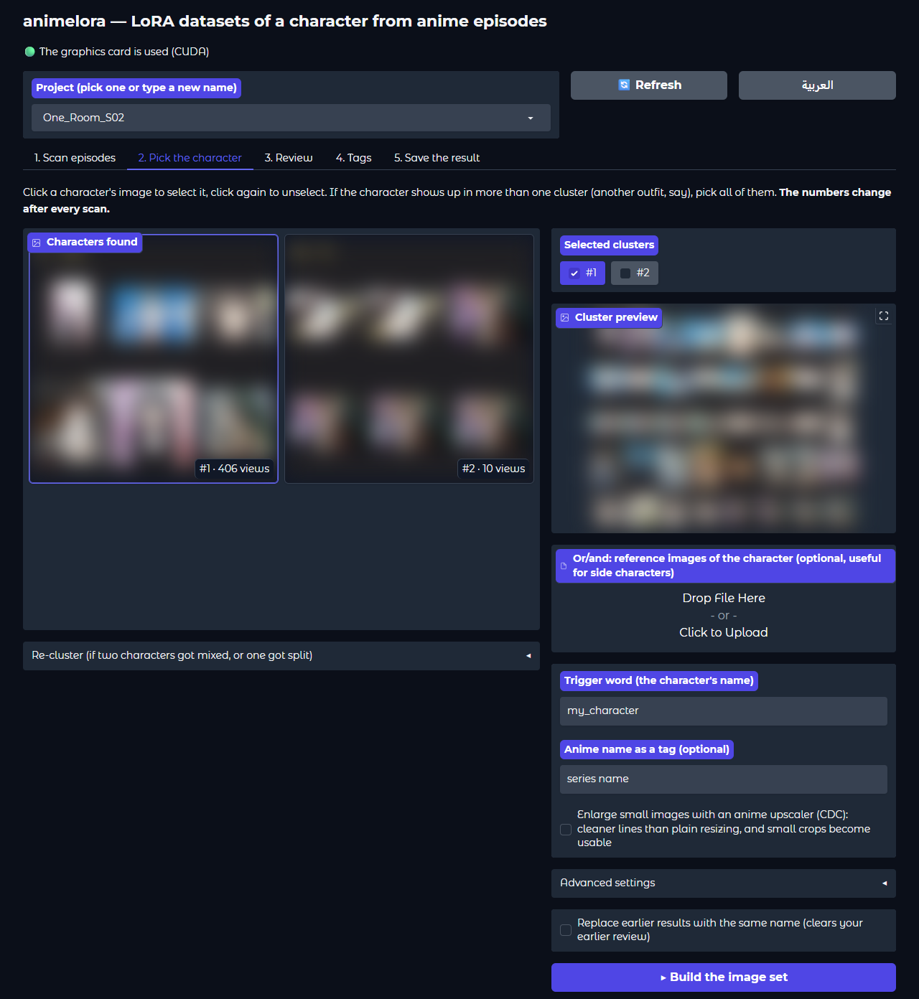
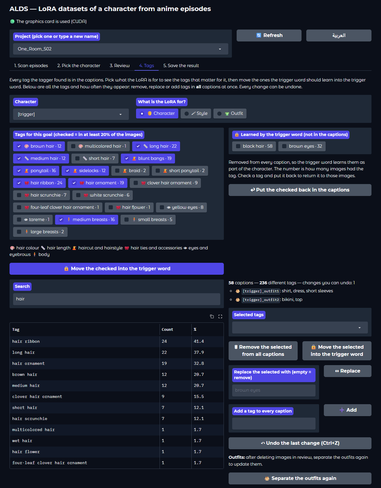
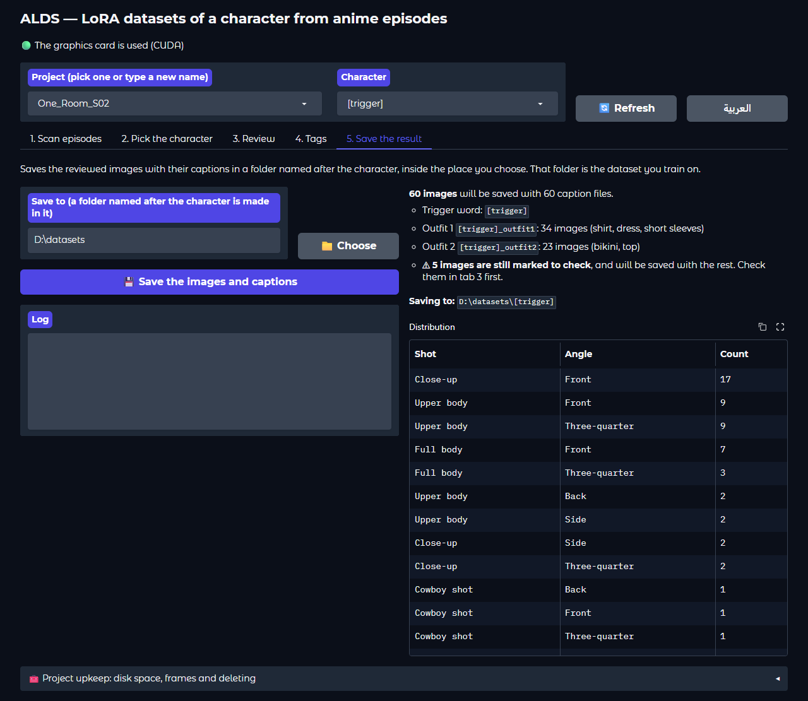
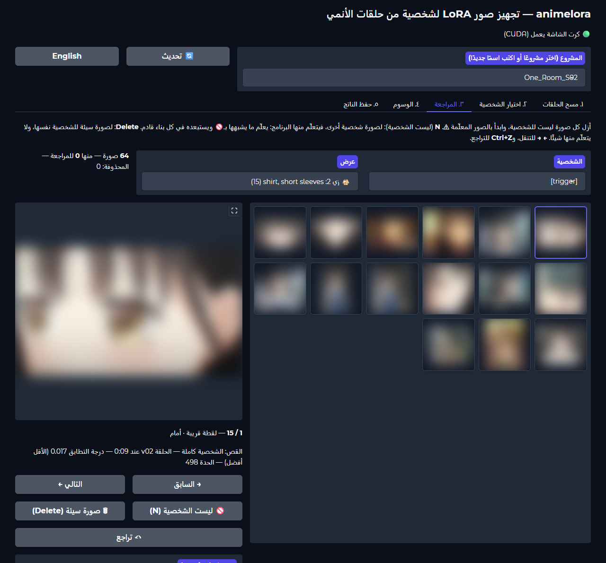

<h1 align="center">ALDS</h1>

<p align="center">
  Turn anime episodes into a clean, captioned LoRA dataset for one character.<br>
  Made for training <b>Anima</b> LoRAs in <b>AI Toolkit</b>, with an Arabic and English interface.
</p>

<p align="center">
  <a href="https://github.com/DVNM3/ALDS/releases/latest"></a>
  
  
  <a href="LICENSE"></a>
</p>

<p align="center">
  <a href="https://dvnm3.github.io/ALDS/">Project page</a> ·
  <a href="#installing">Install</a> ·
  <a href="#using-the-interface">Usage</a> ·
  <a href="#command-line">Command line</a> ·
  <a href="https://github.com/DVNM3/ALDS/releases">Releases</a>
</p>



Making a character LoRA from an anime usually means hours of taking screenshots, sorting them and writing captions. ALDS does it from the episode files: it finds every character in the episodes, lets you pick yours, and builds a sorted, captioned set of the scenes where your character is alone, which you review in a few minutes and train on.

## Features
- **Finds your character.** Every character in the episodes is detected and grouped by identity, so you pick yours with one click.
- **Your own images too.** Add images of the character you already have: they're tagged and enlarged like the scenes, kept with the character for later builds, and help find it in the episodes (useful for side characters). With no episodes at all, the program tags and enlarges your images alone.
- **Skips the opening and ending.** The OP/ED and long recaps are found by comparing the episodes with each other, and left out.
- **Whole scenes, character alone.** Only the frames where your character is the only one on screen are used, uncut. Another detected person, or a tagger count such as `1girl` and `1boy`, leaves the scene out, and so does a character smaller than half the frame height (adjustable).
- **Leaves out other characters.** The clusters you didn't pick show what the other characters look like, so images that resemble one of them more than yours are left out before you review.
- **Filters out bad images.** On-screen text, dark or faded frames, black-and-white or sepia flashbacks, chibi and blurry drawings, and near-duplicates.
- **Captions in Anima's style.** WD14 tags in Anima's order with your trigger word. Every tag is written; you choose which ones the trigger word learns.
- **Sorted by shot and angle.** From close-up to full body, and front, three-quarter, side, back, from above and from below.
- **Separates outfits.** When the character wears more than one outfit, each outfit gets its own tag.
- **Learns from your review.** Confirm clear images of the character, or reject another character. Doubtful images come first, and you can see the effect before building again.
- **Anime upscaler (optional).** Scenes smaller than your training size are enlarged with a model made for anime. You choose the model: waifu2x (closest to the original), Real-ESRGAN animevideov3, AnimeSharp, APISR or CDC. None of them ships with the program: a model is downloaded when you choose it, and you can delete it again to free the space.
- **Fast rebuilds.** The analysis is saved, so trying other thresholds or options takes seconds instead of minutes.
- **Saved versions.** Every rebuild keeps the previous result, which you can compare or bring back. Your review carries over to the new build: edited captions, moved and removed images, and bulk tag edits.
- **Frames can be restored.** After cleaning, missing frames come back from the original episodes, without scanning again.
- **Settings preview.** Try the settings on 12 frames first and see why each scene was kept or left out.
- **Safe to stop.** Every long action can be stopped, and whatever it made is removed.
- **Ready for AI Toolkit.** From the command line, export can balance the angles and write a job config with the step schedule worked out for your image count.

## Screenshots
Pictures taken from the episodes are blurred here; in the program they show as they are.

<table>
  <tr>
    <td width="50%" valign="top">
      <a href="docs/screenshots/pick.png"></a>
      <br><b>Pick the character.</b> Every character found in the episodes gets a card. Click yours, type a trigger word, add your own images if you have some, and build the image set.
    </td>
    <td width="50%" valign="top">
      <a href="docs/screenshots/tags.png"></a>
      <br><b>Tags.</b> Pick what the LoRA is for (character, style or outfit) and move the tags the trigger word should learn into it. Below, every tag with its count: remove, replace or add a tag in all captions at once, with undo.
    </td>
  </tr>
  <tr>
    <td width="50%" valign="top">
      <a href="docs/screenshots/save.png"></a>
      <br><b>Save the result.</b> A summary before saving: the outfits, the upscaled images and the shot and angle distribution.
    </td>
    <td width="50%" valign="top">
      <a href="docs/screenshots/review-ar.png"></a>
      <br><b>Arabic interface.</b> The same page right to left, one button away.
    </td>
  </tr>
</table>

## Requirements
- Windows 10 or 11 and [Python 3.12](https://www.python.org/downloads/).
- An NVIDIA graphics card with CUDA is strongly recommended. The program runs on the processor alone, but slowly. A scan uses up to about 8 GB of graphics memory.
- Free disk space: the extracted frames take a few hundred megabytes per episode until you clean them up.
- [AI Toolkit](https://github.com/ostris/ai-toolkit) to train the LoRA afterwards.

## Installing
1. Download the ZIP of the [latest release](https://github.com/DVNM3/ALDS/releases/latest) and extract it, or clone the repository:
   ```bat
   git clone https://github.com/DVNM3/ALDS.git
   ```
2. Double-click **`setup.bat`**. It checks for Python 3.12, creates the Python environment in `.venv`, installs the requirements (about 2 GB the first time) and then checks the setup: packages, graphics card, CUDA, video decoding and free disk space. If it stops, read the message and double-click it again; it continues where it stopped.
3. Double-click **`alds-gui.bat`**. The models download from Hugging Face by themselves on the first run.

To try every step on one episode before real work, run `alds.bat selftest "D:\anime\episode.mkv"` (see [Self-test](#self-test)).

<details><summary>Without setup.bat</summary>

```bat
py -3.12 -m venv .venv
.venv\Scripts\python.exe -m pip install -r requirements.txt
```
</details>

**Updating:** run `git pull` in the program folder, or replace the `alds` folder with the one from the new ZIP. Your `projects` folder, `settings.json` and `.venv` stay as they are. Then double-click `setup.bat` again, in case the requirements changed.

**New versions:** when the interface starts, it asks GitHub once whether a newer release exists, and shows a link under the title if there is one. Nothing else is sent. To turn it off, add `"check_updates": false` to `settings.json`.

## Using the interface
Double-click **`alds-gui.bat`**. The interface opens in your browser at `http://127.0.0.1:7860` and only runs on your computer. To stop it, close the black command window.

At the top you pick the **project** (or type a new name) and the **character**. Tabs 3, 4 and 5 work on that character, and tab 2 fills in its trigger word, clusters, your images and its last build settings, ready to build again.

The **العربية / English** button at the top switches the language in place, without losing anything you did on the page. The language you used last opens on the next start.

The tabs follow the work from left to right:

| Tab | What you do there |
|---|---|
| **1. Scan episodes** | Drop the episode files on the box, or press “📂 Choose episodes” or “📁 Choose a folder of episodes”, then “Start scanning”. The OP/ED is found automatically and its times show in the episodes table. When the scan ends, tab 2 opens. |
| **2. Pick the character** | Click your character's card (you can pick more than one), type the trigger word, add your own images if you have some, and press “Build the image set”. A character that's already built is built again: the current result is saved as a version first and your review carries over. If two characters got mixed in one card, select it and press “✂ Split”. |
| **3. Review** | Opens by itself after a build, with the images marked ⚠ first. Remove what isn't right, fix a caption, move an image to another group, or show one outfit only. |
| **4. Tags** | Pick what the LoRA is for: character, style or outfit. The tags that matter for it are listed by kind (hair colour, haircut, hair ties, tattoos and marks, earrings, clothes...), and the ones in at least 20% of the images are checked. Moved tags leave every caption and sit in the trigger word box; put one back and it returns to the images it was in. Below, every tag and how often it appears: remove, replace or add a tag in all captions at once, with undo. |
| **5. Save the result** | Choose a place; a folder named after the character is made there with the images and their caption files. That folder is your dataset. “🧰 Project upkeep” shows the project's size, cleans it up, restores frames and deletes the project. |

Review keys:

| Key | Action |
|---|---|
| **N** | Not this character: an image of another character. The program learns from it and leaves out what looks like it from now on. |
| **Delete** | Bad image of the character itself. It's only removed. |
| **← →** | Previous and next image. |
| **Ctrl+Z** | Undo the last removal. |
| **Ctrl + click**, **Shift + click** | Pick several images (Shift picks a range). ✅, 🚫, 🗑 and ↪ Move then act on all of them, and **Ctrl+Z** undoes the whole batch. |
| **Ctrl+A** | Pick every image shown, for example every image under “🚫 Like what you rejected”. |
| **Esc** | Clear the picked images. |

- **Progress:** every long action shows a progress bar under its button and writes each step to its log box as it goes, in the interface language.
- **Stop button:** every long action shows one while it runs. The action stops within seconds and the project is back exactly as it was, so starting again begins from the start. The same happens when an action fails, and with **Ctrl+C** on the command line.
- Removed images aren't deleted for good: they move to a `_deleted` folder inside the character folder.
- **🕘 Saved build versions** (Review tab): save, compare, restore or delete a version. Images that didn't change are stored only once.
- **Preview these settings** (Pick the character): runs the filters on 12 frames spread over the episodes. Upscaling and outfit tags only run in the full build.
- **Choosing episodes:** the buttons open the Windows file window and use the files where they are. A dropped file goes through the browser, so the program looks for the same file on the disk (same name and size, in the folders you used before, Downloads, Videos, Desktop and Documents) and uses it there; if it isn't found, a copy is kept inside the project, marked 📥. You can also paste a path into the episode list and press Enter.
- **Your own images** (Pick the character): drop them on the box or click it. They skip the scene filters, so every image you add is kept, and they're saved with the character: the list shows them again next time, and × removes one. Untick “Add them to the image set” to use them only to find the character, or “Use them to find the character in the episodes” to only add them.
- **Restore missing frames** (Project upkeep): leave the folder empty to use the episodes where they were, or choose their new folder. Use the original files, not re-encoded copies.
- **Upscaling model** (Pick the character): choosing a model downloads it, once, into the shared model folder `%USERPROFILE%\.cache\huggingface`, not into the program folder. **🗑 Delete this model to free space** removes it; press **!** next to a model to read what it does, where it comes from and its licence. waifu2x, AnimeSharp and APISR have a 2x and a 4x version: **Automatic** uses 2x for enlargements up to double and 4x above, and choosing one version downloads only that one.

## Where your files go
Everything the program makes stays in the `projects` folder next to it, one folder per project:

```
projects\<project>\
  frames\        extracted frames (the biggest part; free it with "clean")
  clusters\      the character cards and sheets
  cache\         saved analysis that makes rebuilds fast
  characters\<name>\
    sorted\close_up\front\ ...   a PNG image + a .txt caption, sorted by shot and angle
    sorted\_review\ ...          doubtful images to check first
    own\                         your own images of the character, as you added them
    report.txt                   the build steps, statistics and the angle distribution
    versions\<version>\          earlier results: images, captions and review
  previews\<name>\               last settings preview (separate from the finished images)
  episodes\                     copies of dropped episodes that weren't found on the disk
```

“Save the result” (or `export` on the command line) copies the reviewed images and captions into one flat folder: the dataset you point AI Toolkit at, with caption extension `txt`.

## How a build works
| Stage | How |
|---|---|
| Recognising the character | CCIP compares every detected character with the references; the default threshold is 0.13. |
| Other characters | Images from the clusters you didn't pick that don't look like your character are used to leave out frames closer to another character than to yours (`--no-auto-reject` turns it off). |
| Scenes | The whole frame, never cut. Only frames where your character is alone: no other person detected, and the tagger counts one person. The character must be at least half the frame height (`--min-height`). |
| Leaving out | Text on screen (read with OCR), dark or faded frames, black-and-white or sepia flashbacks (`--keep-mono` keeps them), chibi and blurry drawings. |
| Removing duplicates | Visual similarity (WD14 embedding) ≥ 0.80; the sharpest image is kept. |
| Tags | WD14 EVA02-Large, in Anima's style: lowercase, spaces instead of `_`. |
| Caption order | `anime screencap, safe, 1boy, <trigger>, <series>, <tags...>` |
| Fixed features | Every tag is written. In the Tags tab you move the ones the trigger word should learn (hair, eyes, tattoos...) out of the captions. |
| Small details | Tattoos, hair ties and earrings are easy to miss. When one is clearly found in several images of the character, it is also accepted where the tagger was less sure (score 0.2 or more). |
| Angle | Tags give side, back, from above and from below; where the eyes sit inside the face separates three-quarter from front. |
| Outfits | Images grouped by their clothing tags and how they look, with a tag per outfit when there is more than one. |
| Upscaling (optional) | Every scene smaller than 1024 pixels (the square root of its area) is enlarged with the model you choose, at most 4×. The model runs on small tiles, so it needs little graphics memory. |

## Command line
Everything in the interface is also available as commands, plus balancing and AI Toolkit job configs on export.

```
scan  →  pick the character's number  →  build  →  review  →  export
```

| Command | What it does |
|---|---|
| `scan` | Extract frames, find the characters and group them into numbered clusters. |
| `autoskip` | Find the OP/ED again, or turn it off with `--off`. |
| `clusters` / `split` | Re-cluster the project, or split one mixed cluster. |
| `build` | Make the character's sorted, captioned images. |
| `reject` | Mark images as another character, or list the ones that look like rejected images. |
| `tags` / `outfits` | Edit tags in bulk; separate the outfits again. |
| `export` | Copy the reviewed images into one dataset folder, optionally balanced, with an AI Toolkit config. |
| `clean` | Free disk space. |
| `restore-frames` | Recover missing character frames from the original episodes. |
| `upscalers` | List the upscaling models; `--download NAME` or `--delete NAME` to free space. |
| `versions` | List, save, compare, restore or delete a character's saved versions. |
| `gui` | Open the interface. |
| `check` | Check the installation: Python, packages, graphics card, CUDA, video decoding, disk space. |
| `selftest` | Run every step on one episode in a temporary folder, and report what works. |

`alds.bat <command> --help` lists every option of a command.

### scan
```bat
alds.bat scan -p fairytail "D:\anime\ep01.mkv" "D:\anime\ep02.mkv"
```
- A whole folder works instead of files. Running `scan` again on the same project adds new episodes.
- **OP/ED:** every part repeated between episodes for 40 seconds or more is left out. With a single episode, the next episode in the same folder is used for the comparison, without extracting anything from it. `--no-auto-skip` turns it off, `--auto-min 60` changes the length, and `--skip 0:00-1:30` ignores more times by hand.
- The result is `projects\<p>\clusters\overview.jpg`, with a row per character and its number. **Cluster numbers change after every scan.**
- `alds.bat split -p fairytail --cluster 3` splits a cluster where similar characters got mixed; the other clusters keep their numbers. `--cut 0.10` splits harder.

### build
```bat
alds.bat build -p fairytail -n natsu_ft --cluster 2 --series "fairy tail"
```
- `-n` is the trigger word, also the name of the character folder.
- `--cluster 2 5` when the character is split over more than one cluster; `--ref folder` for 3 to 10 reference images instead of, or as well as, cluster numbers.
- `--images folder` adds your own images of the character: tagged and enlarged like the scenes, kept with the character for later builds, and also used to find it (`--no-images-find` turns that off).
- Building again with other settings only analyses what's new; `--fresh` redoes everything.
- `--preview` tries the settings on 12 frames and leaves the built images alone; `--preview 24` for more (up to 60). The scenes and the reason for each are written to `projects\<p>\previews\<name>\`.

### versions
```bat
alds.bat versions -p fairytail -n natsu_ft --save
alds.bat versions -p fairytail -n natsu_ft
alds.bat versions -p fairytail -n natsu_ft --compare VERSION_ID
alds.bat versions -p fairytail -n natsu_ft --restore VERSION_ID
alds.bat versions -p fairytail -n natsu_ft --delete VERSION_ID
```
Take the ID from the list. Every rebuild saves the current result first, and so does restoring, so you can always go back. A version holds the images, captions, confirmations, rejections, your own images and reference images.

When you rebuild, your review carries over to the images from the same episode and time: edited captions, group moves and removed images. Bulk tag edits are applied to the new images too, tags in the trigger word box stay out of the captions, and outfit tags follow the new outfit split. If the rebuild fails or is stopped, the previous result comes back.

### Self-test
```bat
alds.bat selftest "D:\anime\episode.mkv"
```
Runs the whole program on one episode in a temporary folder, then deletes it; your projects aren't touched. It checks the setup, then scans the episode (a 2.5-minute part of a long episode), builds the character found most often together with one image of your own, checks every caption, confirms, rejects and deletes images and undoes each, moves a tag into the trigger word and back, saves a version and the dataset, and tries the upscaler if a model is downloaded. Each step is marked `[ok]` or `[failed]`, with how long it took. Without an episode it uses the shortest one you scanned before. `--keep` keeps the test folder.

### review
In the interface, or by hand: open the `sorted` folder and delete every image that isn't the character, starting with `_review`. The `.txt` captions can be edited too.

**Definitely this character** adds the image as an extra reference for the character. Pick clear images from different angles and outfits. They are listed under **Confirmed images and the effect of your review**, where a wrong confirmation can be taken back.

**❓ Unsure who it is** shows weak matches and images close to another character first. The match score shown is lower for images closer to the character; it isn't a percentage.

**Preview the effect** shows which frames your confirmations and rejections add or leave out, with up to 24 examples. It changes nothing; the counts are frames, before filtering.

```bat
alds.bat reject -p fairytail -n natsu_ft v01_00616.0s_full.png
alds.bat confirm -p fairytail -n natsu_ft v01_00616.0s_full.png
alds.bat confirm -p fairytail -n natsu_ft --remove v01_00616.0s_full.png
alds.bat feedback -p fairytail -n natsu_ft
alds.bat tags -p fairytail -n natsu_ft --remove parody --replace "yellow eyes=brown eyes"
alds.bat tags -p fairytail -n natsu_ft --undo
alds.bat tags -p fairytail -n natsu_ft --goal character
alds.bat tags -p fairytail -n natsu_ft --absorb "pink hair" "shoulder tattoo"
alds.bat tags -p fairytail -n natsu_ft --restore "shoulder tattoo"
alds.bat outfits -p fairytail -n natsu_ft
```
- `reject` learns an image as another character and lists the ones that look like it; `--clear` forgets all rejections.
- `confirm` without image names lists the confirmations; `--remove` takes one back. `feedback` prints the same comparison as the preview.
- `tags` without options lists every tag and its count. Outfit tags can be renamed with a replace, such as `natsu_ft_outfit1=natsu_ft_coat`.
- `--goal character|style|outfit` lists the tags that matter for that kind of LoRA (`*` = in at least 20% of the images). `--absorb` moves tags into the trigger word (out of every caption); `--restore` puts them back where they were.
- `outfits` separates the outfits again after images were removed; `--no-outfits` on `build` skips them.

### export
```bat
alds.bat export -p fairytail -n natsu_ft --total 100
```
Copies the images and captions into one folder, `train\`.
- `--total 100` balances the angles: the count is spread over the angle folders by the square root of their size, and the picks inside each folder are varied but typical. `--max-per-group 15` caps each folder instead.

**Straight into AI Toolkit, with a job config:**
```bat
alds.bat export -p fairytail -n natsu_ft --total 60 --aitk "E:\AI-Toolkit-Easy-Install\AI-Toolkit" --dataset-name natsu_dragneel
```
- The images go to `AI-Toolkit\datasets\natsu_dragneel\`. The AI Toolkit path is remembered, so later `--aitk` alone is enough.
- The job config is made from `ALDS\aitk_template.yaml` and saved in the character folder and in `AI-Toolkit\config\`. In AI Toolkit, create a new job and paste it in Advanced mode.
- The schedule is worked out from the number of exported images:
  - `Save Every = Sample Every = round(images × resolutions × 10 ÷ 4)`
  - `Steps = Save Every × (epochs ÷ 10)`
  - `Max Saves = epochs ÷ 10`
  - Batch 1, gradient accumulation 4, warmup 100.
- `--epochs 50` or `60` instead of 40, and `--res 512 1024` for the resolutions.
- The job name gets the next free version (`Natsu_Dragneel_v1`, `v2`, ...), and the sample prompts use `1girl` or `1boy` to match the character, with one prompt per outfit.
- A dataset folder the program didn't make is never overwritten. To change the fixed training settings (network, learning rate, EMA, negative prompt...), edit `ALDS\aitk_template.yaml`.

### clean
```bat
alds.bat clean -p fairytail
alds.bat clean -p fairytail --all
```
- **Without `--all`:** deletes the frames the program will never read again (inside the OP/ED or without characters), the thumbnails, the settings previews and unused images in `cache`. Building and clustering keep working.
- **With `--all`:** deletes every frame and the saved analysis. Finished images and versions stay; restore the frames before building or clustering again.

### restore-frames
```bat
alds.bat restore-frames -p fairytail
alds.bat restore-frames -p fairytail --videos-dir "D:\anime\moved-season"
```
Only the missing frames with a character are decoded, by their frame number and time; frames inside the OP/ED are skipped. The program checks the resolution, frame rate, duration and timing, and for scans made with this version the exact file too. If an episode is missing or different, nothing is changed.

## Tuning
- `report.txt` lists the build steps and says how many frames are just above the match threshold. If other characters slip in, lower `--threshold` (e.g. 0.11); if there are too few images, raise it (e.g. 0.15).
- `--sim 0.85` keeps more similar images; `0.75` removes duplicates more strictly.
- `--min-height 0.6` leaves out scenes where the character is smaller than 60% of the frame height (default 0.5).
- `--upscale --upscale-to 1024 --upscaler waifu2x` upscales smaller scenes to your training resolution. Models: `waifu2x` (default, closest to the original), `animevideov3` (crisper lines), `animesharp` (sharp), `apisr` (redraws the lines and changes the style) and `cdc` (adds grain; ALDS used it up to version 0.4.1). `--upscaler-version 2` or `4` uses one version of a model that has both (default `auto`: 2x up to double, 4x above). A model that isn't downloaded yet is downloaded on first use; `alds.bat upscalers` shows which are.
- `--save-dropped` keeps the left-out images in `_dropped\<reason>\`, to check the filters.
- `--overwrite` saves a version, builds again and carries your review over.

## Development checks
```bat
.venv\Scripts\python.exe -m unittest discover -s tests -v
```
The tests use temporary projects and generated videos, with stand-ins for the models: nothing is downloaded and your projects aren't touched.

## Built with
- [imgutils](https://github.com/deepghs/imgutils) by deepghs: character detection, CCIP identity features, OCR, the CDC upscaler and the WD14 tagger interface.
- Upscaling models: [waifu2x](https://github.com/nagadomi/nunif) by nagadomi (ONNX from deepghs), [Real-ESRGAN](https://github.com/xinntao/Real-ESRGAN) animevideov3, [AnimeSharp](https://huggingface.co/Kim2091/AnimeSharp) by Kim2091 and [APISR](https://github.com/Kiteretsu77/APISR). They are downloaded on first use, under their own licences.
- [WD14 taggers](https://huggingface.co/SmilingWolf/wd-eva02-large-tagger-v3) by SmilingWolf for the tags.
- [Gradio](https://www.gradio.app/) for the interface, [PyAV](https://github.com/PyAV-Org/PyAV) for decoding and [scikit-learn](https://scikit-learn.org/) for clustering.

## License
MIT, see [LICENSE](LICENSE).
